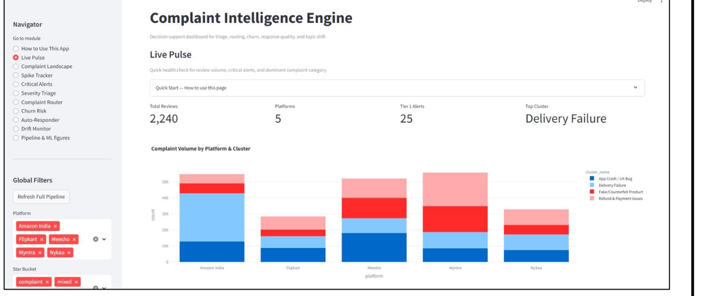
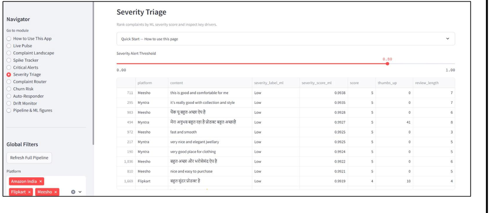
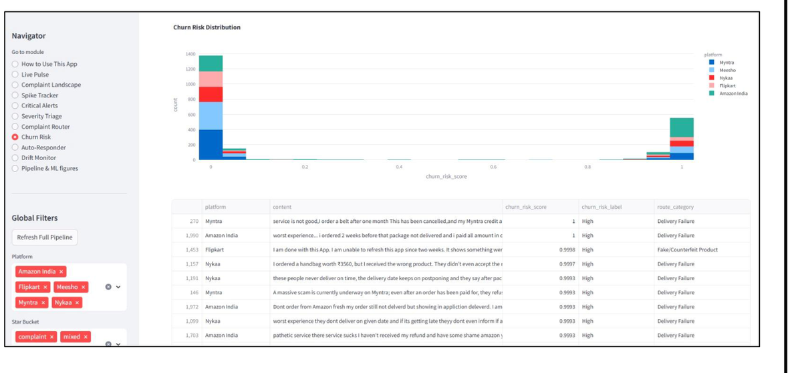
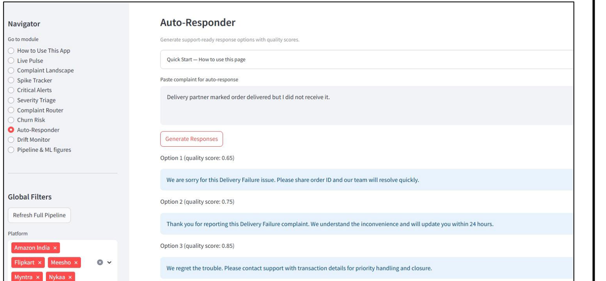
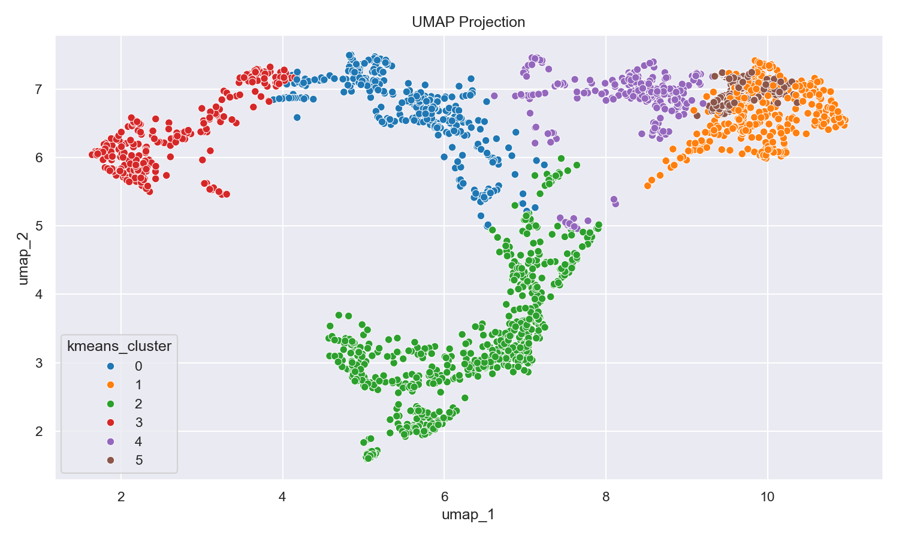
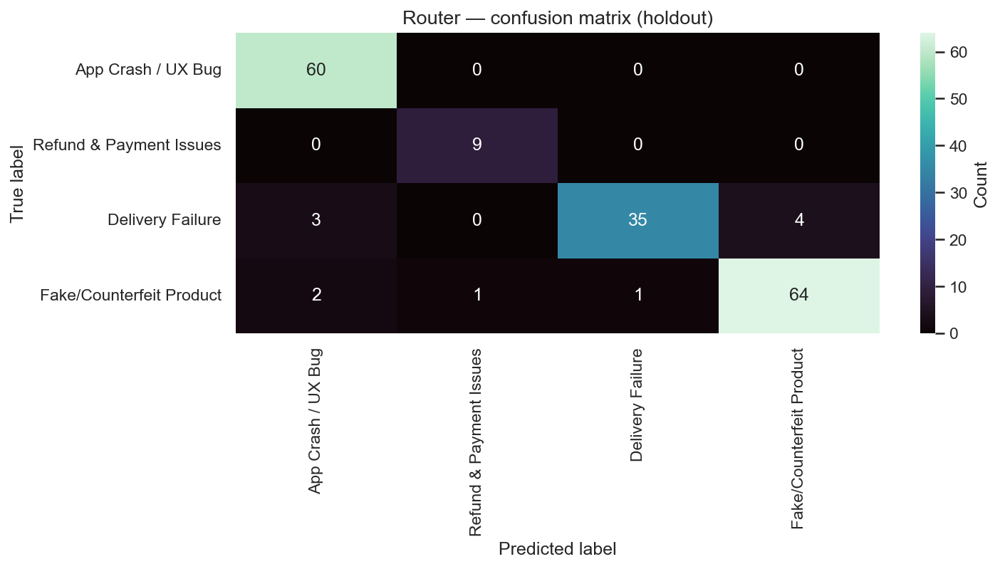
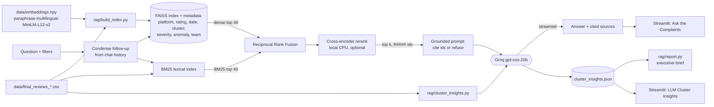

# Complaint Intelligence Engine

**An unsupervised NLP decision support system for Indian e-commerce complaint analytics.**

A twelve stage pipeline that turns raw multilingual reviews into an operations workflow: what is going wrong, how urgent it is, which team owns it, who is about to churn, what to reply, and what is newly emerging. One command produces every data artefact, trained model and evaluation report, plus a working Streamlit dashboard.

**Topics:** `nlp` `unsupervised-learning` `sentence-bert` `hinglish` `clustering` `hdbscan` `anomaly-detection` `streamlit` `ecommerce-analytics` `python`

---

## Why

Indian e-commerce platforms take in millions of reviews a year covering delivery failures, fake products, payment fraud, app crashes and return violations. Manual triage does not scale, and a large share of that text is Hinglish, which most pipelines drop or mangle. CIE keeps the Hinglish signal and does the triage automatically.

## Highlights

- **Hinglish native.** Multilingual Sentence-BERT maps English, Hindi and Romanised Hinglish into one 384 dimensional space, so reviews cluster by meaning regardless of script.
- **No manual labels.** The core layer discovers complaint archetypes with K-Means and HDBSCAN. The supervised layer is then trained on those discovered structures.
- **Dual flagged alerts.** A review is Tier 1 critical only if Isolation Forest ranks it in the top 5% and HDBSCAN calls it noise, which cuts false positives against either method alone.
- **Streamlit dashboard** for live filtering, spike tracking, routing and response drafting.

## Data

Live Google Play Store reviews via `google-play-scraper` (no API key) across Myntra, Meesho, Nykaa, Flipkart and Amazon India, in English and Hindi, country set to India.

| Stage | Count |
|---|---|
| Reviews fetched | 4,768 |
| After merge and clean | 2,387 |
| Final corpus after dedup | 2,240 |
| Hinglish reviews detected | 202 (~9.0%) |
| SBERT embeddings | (2,240, 384) |

## Pipeline

**Core NLP and unsupervised layer (01 to 07)**

| Step | What it does |
|---|---|
| 01 Ingest | Fetch, merge, dedup, drop reviews under 10 characters |
| 02 Preprocess | Light cleaning that preserves Hinglish, TF-IDF for cluster keywords |
| 03 Embed | `paraphrase-multilingual-MiniLM-L12-v2`, 384 dims, ~4 min on CPU |
| 04 Reduce | PCA 384d to 50d, UMAP 50d to 10d, t-SNE 2d for plots only |
| 05 Cluster | K-Means (k chosen by silhouette) and HDBSCAN on UMAP-10 |
| 06 Anomaly | Isolation Forest, One-Class SVM, rolling z-score spike detection at 2.5 sigma |
| 07 Visualise | Static PNG exports of volumes, spikes and cluster heatmaps |

**Supervised extension layer (08 to 12)**

| Step | What it does |
|---|---|
| 08 Severity | Escalation risk from weak labels built on legal and fraud keywords, rating and engagement |
| 09 Router | Routes to Delivery, Payments, Product Quality, App Issues or General, trained on high confidence K-Means assignments |
| 10 Churn | Churn risk proxy from complaint bucket, rating and review length, with balanced class weights |
| 11 Response | Three template variants per complaint, scored for empathy, specificity and actionability |
| 12 Drift | Weekly embedding centroid shift and Jensen-Shannon divergence to catch new complaint types |

## Results

From one documented run. Re-running on fresh reviews changes every figure.

| Task | Selected model | Metric | Score |
|---|---|---|---|
| Severity | Logistic Regression | Weighted F1 | 1.0 (CV 0.999) * |
| Router | LinearSVC on TF-IDF | Macro F1 | 0.936 (CV 0.933) |
| Churn | Gradient Boosting | PR-AUC | 1.0 (CV 0.997) * |
| Response | template_v3 | Mean quality | 0.590 |
| Drift | Weekly centroid + JS | Alert rate | 4 of 27 weeks |

Clustering: 4 data driven clusters, silhouette 0.12 to 0.25 (normal range for noisy real world review text), K-Means vs HDBSCAN ARI ~0.67, 25 Tier 1 critical reviews out of 112 flagged by Isolation Forest, spike detection false positive rate ~1.2%.

\* The near perfect severity and churn scores come from weak label and feature alignment, not from genuine difficulty. Treat them as a sanity check on the labelling rules rather than as generalisation estimates.

## Dashboard

How to Use This App, Live Pulse, Complaint Landscape, Spike Tracker, Critical Alerts, Severity Triage, Complaint Router, Churn Risk, Auto-Responder, Drift Monitor, Pipeline & ML figures, Ask the Complaints (RAG), and LLM Cluster Insights. Global filters for platform, star bucket and date range, and a button that re-runs the full pipeline and clears cache.

A typical 15 minute ops review: spot a jump in Tier 1 alerts, confirm the spike is statistically real, read the top critical reviews, route one to the owning team, pull the high churn risk users behind it, draft a response, and check whether drift confirms a new sub-issue.

## Screenshots

<table>
<tr>
<td width="50%">

**Live Pulse**<br>KPI overview and complaint volume by platform and cluster


</td>
<td width="50%">

**Severity Triage**<br>Complaints ranked by ML severity score with an adjustable alert threshold


</td>
</tr>
<tr>
<td width="50%">

**Churn Risk**<br>Churn score distribution and the high-risk user watchlist


</td>
<td width="50%">

**Auto-Responder**<br>Generated reply options with quality scores for a pasted complaint


</td>
</tr>
<tr>
<td width="50%">

**UMAP cluster projection**<br>Discovered complaint archetypes in the reduced embedding space


</td>
<td width="50%">

**Router confusion matrix**<br>LinearSVC routing accuracy on a platform group holdout


</td>
</tr>
</table>

## GenAI layer: RAG over the complaints

A retrieval augmented layer that answers free-form analyst questions directly from the review corpus,
citing the reviews it used. It reuses the exact Sentence-BERT vectors from `03_embed.py`, so retrieval,
clustering and anomaly detection share one embedding space. Everything runs free: Groq's free tier for
the LLM, local CPU for embedding and reranking.



### Retrieval

Three strategies, selectable per query in the dashboard, with `RAG_RETRIEVER` in `.env`, or `--variant`:

| Variant | Ranking | Role |
|---|---|---|
| `dense` | FAISS cosine over Sentence-BERT vectors | Baseline, fastest |
| `hybrid` (default) | Dense and BM25 fused by Reciprocal Rank Fusion | Recovers exact tokens such as COD, OTP and UPI that embeddings blur, and tolerates Hinglish spelling variants |
| `rerank` | Hybrid shortlist of 40 re-scored by a multilingual cross-encoder | Best ranking, adds local CPU time, no API calls |

RRF fuses ranks rather than scores, because cosine similarity and BM25 occupy different scales. Metadata
filters are applied before ranking, so all three search the same subset.

### Measured results

Retrieval, scored on 26 questions over the 2,240 review corpus against pooled judge-labelled ground truth (`python rag/evaluate.py --compare`,
no LLM calls involved):

| Metric | dense | hybrid | rerank |
|---|---|---|---|
| Hit rate@1 | 0.5 | 0.615 | **0.692** |
| Hit rate@5 | 0.846 | 0.846 | **0.923** |
| MRR@8 | 0.634 | 0.718 | **0.771** |
| Precision@5 | 0.469 | 0.485 | **0.538** |
| Recall@8 | **0.499** | 0.453 | 0.487 |
| Latency p50 | 41 ms | 43 ms | 1.875 s |

Answer quality, hybrid retrieval, answer model `openai/gpt-oss-20b`, independent judge `openai/gpt-oss-120b`:

| Metric | Value |
|---|---|
| Faithfulness (judge, 1 to 5) | 4.65 (91% scored 4 or 5) |
| Answer relevance (judge, 1 to 5) | 4.87 |
| Answers with citations / valid citation ids | 100% / 100% |
| Correct refusals on out of corpus questions | 100% (4/4) |
| False refusals on answerable questions | 11.5% |
| End to end latency median / mean / p95 | 3.02 s / 4.639 s / 12.697 s |

Caveats: 25 of the 26 scored questions use pooled judge labels and 1 falls back to keywords. Recall is low in
absolute terms because several questions have more than 8 relevant reviews while only 8 reach the prompt, so
hit rate and MRR are the meaningful metrics here. The p95 latency reflects free-tier rate-limit backoff. An LLM judge approximates human evaluation, which is why the judge is a larger, different model.

Per question results are in `rag/eval_results.json`, variants in `rag/eval_variants.json`, labels in
`rag/eval_labels.json`.

### Commands

```bash
python rag/chain.py "Why are refunds delayed?" --platform Meesho --variant rerank
python rag/report.py --platform Flipkart --days 30     # writes rag/reports/*.md
python rag/evaluate.py --compare                       # no API key needed
python -m pytest tests -q
```

### Tests and CI

`tests/` holds 30 tests covering the tokenizer, metadata filtering, RRF fusion, citation parsing, metric maths
and retry logic. None call an LLM. `.github/workflows/ci.yml` builds the index, checks the build is idempotent,
runs the tests and scores retrieval, all without an API key, so CI cannot incur cost.

## Tech stack

Python, pandas, NumPy, SciPy, scikit-learn, sentence-transformers, PyTorch, langdetect, umap-learn, hdbscan, joblib, Streamlit, Plotly, matplotlib, seaborn, google-play-scraper, LangChain, FAISS, rank-bm25, pydantic and pytest. Everything is open source and pip installable. The core pipeline needs no keys, and the GenAI layer runs on a free Groq key plus local CPU models.

## Setup

```bash
python -m venv .venv
source .venv/bin/activate        # Windows: .venv\Scripts\activate
pip install -r requirements.txt

python run_pipeline.py           # first run takes 8-12 min on CPU

cp .env.example .env             # add a free GROQ_API_KEY from console.groq.com
python rag/build_index.py        # build the FAISS index (about 30 seconds)
python rag/cluster_insights.py   # generate LLM cluster labels

streamlit run app.py             # opens http://localhost:8501
```

For the GenAI layer, add a free `GROQ_API_KEY` to a `.env` file (see the GenAI section). For Streamlit Community Cloud, set the same value as a secret.

## Limitations

Play Store reviews skew toward app experience rather than the full order journey. Hinglish detection is dictionary based and will miss unusual spellings. Weak labels encode the rules that wrote them, so the severity and churn scores above are not evidence of generalisation. Cluster count and all reported metrics shift with each fresh scrape.
